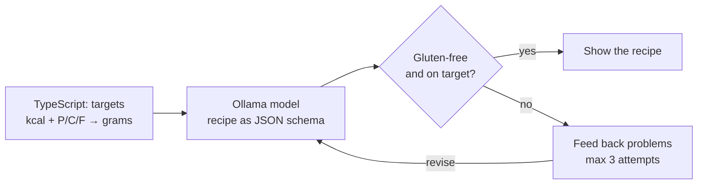

# 01 · Gluten-free chef

A terminal chat that generates gluten-free recipes for a target calorie count and protein/carbs/fat split.

The lesson: let the LLM do what it's good at (writing recipes) and let code do what LLMs are bad at (arithmetic and hard rules).



Targets use the 4/4/9 rule: protein and carbs 4 kcal/g, fat 9 kcal/g. 600 kcal at 30/40/30 = 45 g protein, 60 g carbs, 20 g fat per serving.

The shape of the answer is a Zod schema. `z.toJSONSchema(Recipe)` turns it into the JSON Schema that Ollama's `format` option enforces, and the same schema parses the reply back into a typed object — one definition for both sides of the call.

## Run

```bash
ollama pull qwen3.5:9b          # or set MODEL in chef.ts to what you have
npm run 01
```

If your model isn't a thinking model and the call errors on `think`, remove `think: false`.

## Steps to learn

1. `ollama run qwen3.5:9b` and ask for a 600 kcal gluten-free recipe. Note the macros rarely add up.
2. Run the chat and read the retry log — that feedback loop is the main thing.
3. Run the tests: `npm test`.

## Stretch goals

- [ ] Stream the output (`stream: true` and iterate the response)
- [ ] A web UI
- [ ] Real nutrition numbers from USDA FoodData Central instead of LLM guesses
- [ ] Allergies, weekly meal plan

## Caveats

Macros are LLM estimates; the check proves consistency, not truth. The gluten filter is a keyword list — it misses hidden gluten and flags safe items like "GF breadcrumbs". For coeliac use, read labels.
